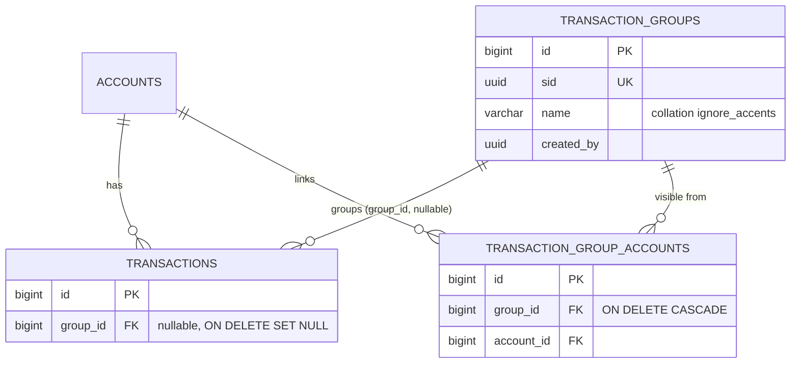
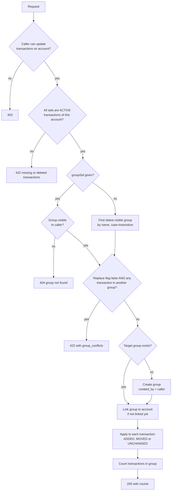
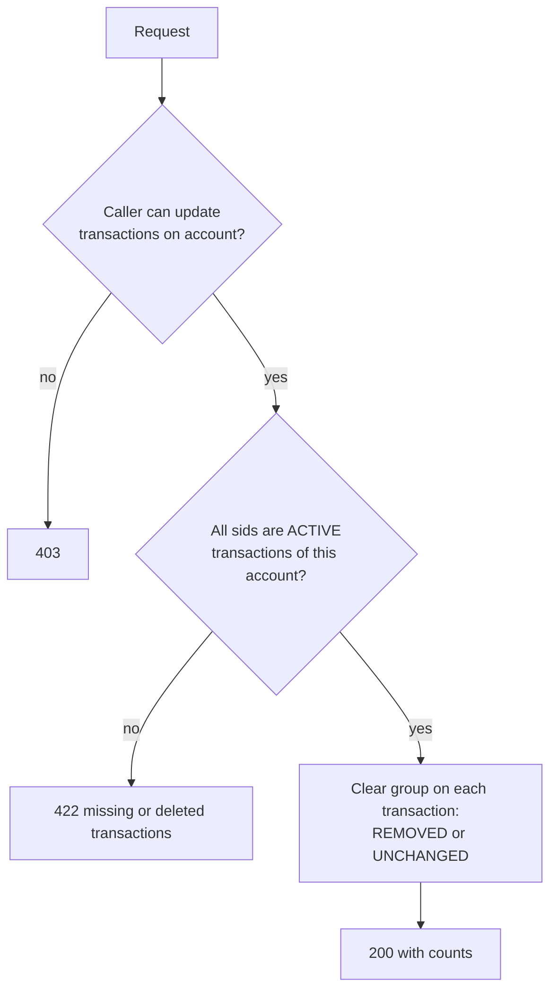
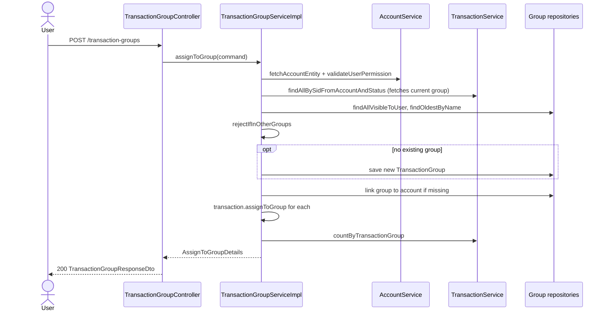

# Transaction groups

Status: implemented on branch `feature/transaction-groups`. Tests are pending, so items marked **unverified** have not been confirmed against a running database.

Last verified: 2026-11-17 against commit `f3ffcab` (read from the code, not run).

## Purpose
A user labels the transactions of an event (a holiday, a party) with a **group**. A transaction belongs to at most one group. A group is visible to every user who can access one of the accounts it is linked to, so a household shares groups without setup.

Out of scope for now: listing groups, group totals, rename, delete.

## Data model



Constraints and indexes:
- `transaction_groups`: unique `(created_by, LOWER(name))`. A user cannot own two groups with the same name; different users may reuse a name.
- `transaction_group_accounts`: unique `(group_id, account_id)`, plus an index on `account_id`.
- `transactions.group_id`: partial index where `group_id IS NOT NULL`.

## Assign transactions to a group

`POST /api/transaction-groups`

Request: `accountSid`, `transactionSids` (1 to 500), either `groupSid` or `groupName`, and `replaceExistingGroup` (default `false`).



Response: `groupSid`, `groupName`, `totalTransactions`, `added`, `moved`, `alreadyInGroup`.

## Ungroup transactions

`POST /api/transaction-groups/ungroup`

Request: `accountSid`, `transactionSids` (1 to 500).



Response: `removed`, `alreadyUngrouped`.

## Sequence: assign by name



## Rules and invariants
- A transaction has zero or one group.
- A group sid is accepted only if the group is linked to an account the caller belongs to. Unknown and invisible groups return the same 404.
- The group-account link is created on every assign, so every account that holds a grouped transaction is linked to its group. Visibility depends on this: keep it true if you add another way to set `group_id`.
- Moving a transaction out of another group is the user's decision, expressed through `replaceExistingGroup`. The backend never moves it silently.
- A transaction already in the target group is left unchanged and counted in `alreadyInGroup`.
- A name matching several visible groups resolves to the oldest (`createdAt`, then `id`).
- The whole request is atomic: any rejection leaves every transaction unchanged.
- Identity comes from the authentication principal, never from the request body.

No rule above is asserted by a test yet. Add the test name next to each rule as the tests land.
## Errors

| Status | Cause | Body |
|---|---|---|
| 400 | Validation: no `accountSid`, empty or oversized list, name over 255 characters, neither `groupSid` nor `groupName` | `invalid_params` by field |
| 403 | Caller lacks update permission on the account | generic detail |
| 404 | `groupSid` unknown or not visible to the caller | generic detail |
| 409 | `DataIntegrityViolationException`, for example a concurrent create of the same name | generic detail, retry |
| 422 | A sid is missing, from another account, or deleted | generic detail |
| 422 | Transactions are in other groups and `replaceExistingGroup` is false | generic detail plus `group_conflicts` |

`group_conflicts` shape:

```json
{
  "group_conflicts": [
    { "groupSid": "uuid", "groupName": "Birthday", "transactionSids": ["uuid", "uuid"] }
  ]
}
```

The user resolves a conflict by resending with `replaceExistingGroup: true`, or without the listed transactions.

## Where the code lives
All paths under `src/main/java/me/ferreira/graveto/moneytracker/transactions/`.

| Concern | Class |
|---|---|
| Endpoints | `web/TransactionGroupController` |
| Request and response DTOs | `web/dto/request/transactiongroup/*`, `web/dto/response/transactiongroup/TransactionGroupResponseDto` |
| Orchestration | `service/impl/TransactionGroupServiceImpl` |
| Commands and results | `service/command/transactiongroup/*`, `service/payload/AssignToGroupDetails`, `UngroupDetails`, `GroupConflict` |
| Domain | `domain/TransactionGroup`, `TransactionGroupAccount`, `GroupAssignmentOutcome`, `Transaction.assignToGroup` and `removeFromGroup` |
| Queries | `repository/transactiongroup/*`, `repository/transactiongroupaccount/*`, `TransactionJpaRepository.countByTransactionGroup` |
| Migrations | `src/main/resources/db/migration/moneytracker/V202610191800__create_transaction_groups.sql`, `V202611141800__add_transaction_group_accounts_index_and_cascade.sql` |
| Error extension | `common/web/exception/ApplicationException.extraProperties`, `GlobalExceptionHandler` |

## Known limits and unverified points
- **Duplicate names across a household:** uniqueness is per creator. Two users creating the same new name at the same moment can end up with two groups. The lookup resolves such a tie to the oldest.
- **Unverified:** `findOldestByName` with an empty visible-groups list (first-ever assign by name).
- **Unverified:** `totalTransactions` assumes Hibernate flushes the pending assignments before the count query runs.
- **Unverified:** whether `LOWER(name)` matches the `ignore_accents` collation for accented names ("Férias" vs "Ferias").
- Concurrent creates of the same name return a 409 from the `DataIntegrityViolationException` handler.
