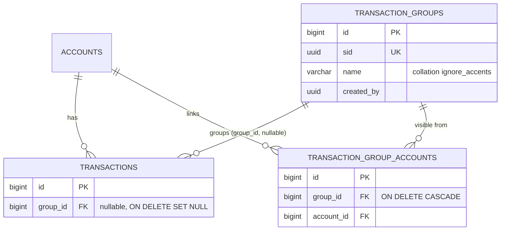
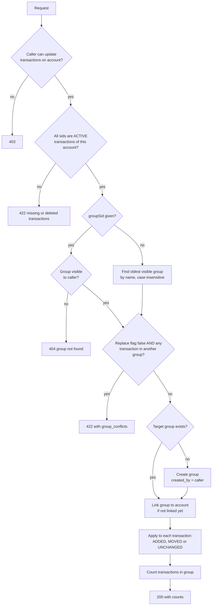
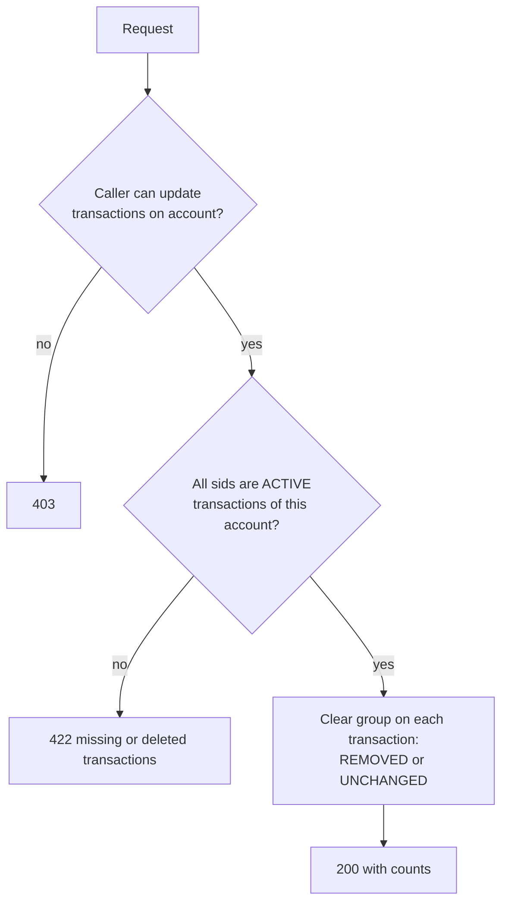
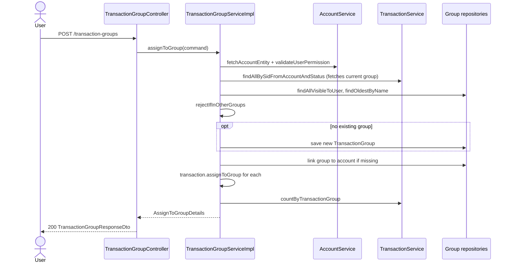

# Transaction groups

Status: implemented on branch `feature/transaction-groups`. Controller, domain, service, exception handler and integration tests are in place. There are no separate repository tests: the queries run in the integration tests. Items still marked **unverified** are listed under known limits.

Last verified: 2026-11-18 against commit `8a62681` plus uncommitted changes (`Transaction.markAsDeleted` clearing the group, and its tests). The group tests in all layers were run and pass, except that after the `markAsDeleted` change only `TransactionTest` was re-run. Everything else was read from the code, not run.

## Purpose
A user labels the transactions of an event (a holiday, a party) with a **group**. A transaction belongs to at most one group. A group is visible to every user who can access one of the accounts it is linked to, so a household shares groups without setup.

Out of scope for now: listing groups, group totals, rename, delete.

## Data model



Constraints and indexes:
- `transaction_groups`: unique `(created_by, LOWER(name))`. A user cannot own two groups with the same name; different users may reuse a name.
- `transaction_group_accounts`: unique `(group_id, account_id)`, plus an index on `account_id`.
- `transactions.group_id`: partial index where `group_id IS NOT NULL`.

## Assign transactions to a group

`POST /api/transaction-groups`

Request: `accountSid`, `transactionSids` (1 to 500), either `groupSid` or `groupName`, and `replaceExistingGroup` (optional, `null` or omitted becomes `false`).



Response: `groupSid`, `groupName`, `totalTransactions`, `added`, `moved`, `alreadyInGroup`.

## Ungroup transactions

`POST /api/transaction-groups/ungroup`

Request: `accountSid`, `transactionSids` (1 to 500).



Response: `removed`, `alreadyUngrouped`.

## Sequence: assign by name



## Rules and invariants
- A transaction that is deleted leaves its group, so group counts and ungroup never see deleted transactions. `Transaction.markAsDeleted` clears the group. It is the only delete path for transactions (`TransactionServiceImpl`) and for both transfer legs (`TransferServiceImpl`), read from the code and not run end to end. Asserted at domain level by `TransactionTest.shouldClearGroupWhenMarkedAsDeleted`, `shouldMarkAsDeletedWhenItHasNoGroup` and `shouldThrowWhenMarkingAnAlreadyDeletedTransactionAsDeleted`. The group-account link stays, so a group whose last transaction was deleted stays visible with no transactions.
- A transaction has zero or one group. Asserted by `TransactionTest.shouldAddTransactionToGroupWhenItHasNone`, `shouldMoveTransactionWhenItIsInAnotherGroup` and `shouldRemoveTransactionFromItsGroup`: assigning replaces the single group reference.
- A group sid is accepted only if the group is among the groups visible to the caller (linked to an account the caller belongs to). Unknown and invisible groups return the same 404. Asserted at service level by `AssignToGroupServiceImplTest.shouldThrowIfGroupSidIsNotVisibleToUser` and `shouldAssignToVisibleGroupBySid`. Asserted end to end by `AssignToGroupIT.shouldReturnNotFoundForGroupVisibleOnlyToAnotherHousehold`, `shouldLetAnotherMemberOfLinkedAccountAssignToTheGroup` and `shouldLinkTheGroupToSecondAccountAndNotDuplicateTheLinkOnRepeat`, which run the real visibility query.
- The group-account link is created on every assign, so every account that holds a grouped transaction is linked to its group. Visibility depends on this: keep it true if you add another way to set `group_id`. Asserted by `AssignToGroupServiceImplTest.shouldCreateGroupAndLinkItToAccountWhenNameMatchesNoVisibleGroup` (link saved for a new group) and `shouldReuseExistingGroupFoundByNameAndKeepExistingLink` (no second link when one exists).
- Moving a transaction out of another group is the user's decision, expressed through `replaceExistingGroup`. The backend never moves it silently. Asserted by `AssignToGroupServiceImplTest.shouldRejectWithGroupConflictsAndChangeNothingWhenReplaceFlagIsFalse`, `shouldReportOneConflictPerOtherGroup` and `shouldMoveTransactionsOutOfOtherGroupsWhenReplaceFlagIsTrue`.
- A transaction already in the target group is left unchanged and counted in `alreadyInGroup`. At domain level, `Transaction.assignToGroup` returns `UNCHANGED` when the target has the same `sid` as the current group, even for a different instance. Asserted by `TransactionTest.shouldLeaveTransactionUnchangedWhenItIsAlreadyInTheTargetGroup` and `shouldTreatGroupsWithTheSameSidAsTheSameGroup`, and for the count by `AssignToGroupServiceImplTest.shouldCountTransactionsAlreadyInTargetGroupWithoutReportingConflict`. Ungroup counts `removed` and `alreadyUngrouped` the same way: `UngroupServiceImplTest.shouldRemoveGroupedTransactionsAndCountAlreadyUngroupedOnes` and `shouldReportZeroRemovedWhenNoTransactionIsGrouped`.
- A name matching several visible groups resolves to the oldest (`createdAt`, then `id`). The service takes the first result of `findOldestByName` (`AssignToGroupServiceImplTest.shouldReuseExistingGroupFoundByNameAndKeepExistingLink`). The ordering lives in the query. Asserted end to end by `AssignToGroupIT.shouldPickTheOldestWhenTwoVisibleGroupsShareTheSameName`.
- The group name is trimmed before the lookup and before a group is created. Asserted by `AssignToGroupServiceImplTest.shouldTrimGroupNameBeforeLookupAndCreation`.
- Only a member whose role can update transactions may assign or ungroup. Asserted by `shouldThrowIfUserCannotUpdateTransactionsDuringAssignToGroup` and `shouldThrowIfUserCannotUpdateTransactionsDuringUngroup`, which use a non-member. Both current roles (`OWNER`, `CONTRIBUTOR`) can update, so a non-member is the only 403 case today.
- The whole request is atomic: any rejection leaves every transaction unchanged. At service level, the conflict case saves no group and no link and leaves every transaction as it was (`shouldRejectWithGroupConflictsAndChangeNothingWhenReplaceFlagIsFalse`), and a missing transaction stops the request before any repository call (`shouldThrowIfSomeTransactionsAreMissingDuringAssignToGroup`). The database rollback comes from `@Transactional` and is **unverified** until the integration tests.
- Identity comes from the authentication principal, never from the request body. Asserted by `AssignToGroupControllerTest.shouldAssignToGroupByNameSuccessfully` and `UngroupControllerTest.shouldUngroupSuccessfully`, which check that the command carries the principal's `userSid`.
- An omitted `replaceExistingGroup` is treated as `false`. Asserted by `AssignToGroupControllerTest.shouldDefaultReplaceExistingGroupToFalseWhenOmitted`.
- The request limits in the errors table are asserted by `shouldReturnBadRequestForInvalidPayloads` in both controller tests.

Tests by layer:

| Layer | Status |
|---|---|
| Controller (`web`) | Done: `AssignToGroupControllerTest` (10), `UngroupControllerTest` (5), helper `TransactionGroupDtoAssertions` |
| Domain | Done: `TransactionTest` (10 group tests), `TransactionGroupTest` (2), `TransactionGroupAccountTest` (1). Covers `Transaction.assignToGroup` (ADDED, MOVED, UNCHANGED), `removeFromGroup` (REMOVED, UNCHANGED), `markAsDeleted` clearing the group, and the two factories |
| Service | Done: `AssignToGroupServiceImplTest` (12), `UngroupServiceImplTest` (5), helper `TransactionGroupUtils`. Repositories and `TransactionService` are mocked, so queries are not exercised |
| Exception handler (`group_conflicts`, 409) | Done: `GlobalExceptionHandlerTest` (6 new tests, 29 in the class). Covers extra properties in the error body, no extras for plain exceptions, and the 409 body, no constraint leak and WARN log. Writing these found and fixed a bug: the extras replaced the whole body map and dropped `timestamp` |
| Integration | Done: `AssignToGroupIT` (15), `UngroupIT` (6). Real Postgres via Testcontainers. Kept to what needs a database: the queries, the collation and unique index, visibility across accounts and households, conflicts, the deleted-status filter, and rejection leaving no change. The 403, the by-sid assign, the ungroup counts and mixed groups are covered by the service and controller tests only. A rollback after a partial write and a real concurrent create are not covered |

Rules without a test name above are not asserted yet. Add the test name next to each rule as the layers land.
## Errors

| Status | Cause | Body |
|---|---|---|
| 400 | Validation: no `accountSid`, empty or oversized list, name over 255 characters, neither `groupSid` nor `groupName` | `invalid_params` by field |
| 403 | Caller lacks update permission on the account | generic detail |
| 404 | `groupSid` unknown or not visible to the caller | generic detail |
| 409 | `DataIntegrityViolationException`, for example a concurrent create of the same name | `Please retry the operation and if needed contact support.` The constraint name is never sent to the client. The cause is logged at WARN. Asserted by `GlobalExceptionHandlerTest.shouldReturnConflictWithRetryMessageOnDataIntegrityViolation`, `shouldNotLeakTheConstraintDetailOnDataIntegrityViolation` and `shouldLogTheCauseAtWarnOnDataIntegrityViolation` |
| 422 | A sid is missing, from another account, or deleted | generic detail |
| 422 | Transactions are in other groups and `replaceExistingGroup` is false | generic detail plus `group_conflicts` |

`group_conflicts` shape:

```json
{
  "group_conflicts": [
    { "groupSid": "uuid", "groupName": "Birthday", "transactionSids": ["uuid", "uuid"] }
  ]
}
```

The user resolves a conflict by resending with `replaceExistingGroup: true`, or without the listed transactions.

`group_conflicts` is a top-level field of the error body, next to the usual `detail`, `title`, `type`, `instance` and `timestamp`. The handler adds every entry of the exception's extra properties to the body and keeps the rest of the envelope. Asserted by `GlobalExceptionHandlerTest.shouldExposeExtraPropertiesAsTopLevelFieldsAlongsideTheEnvelope`. An exception without extra properties adds no extra field (`shouldNotAddAnyExtraFieldWhenTheExceptionHasNoExtraProperties`). The content of the conflicts (one entry per other group, with its transaction sids) is built by the service and asserted by `AssignToGroupServiceImplTest.shouldReportOneConflictPerOtherGroup`.

## Where the code lives
All paths under `src/main/java/me/ferreira/graveto/moneytracker/transactions/`.

| Concern | Class |
|---|---|
| Endpoints | `web/TransactionGroupController` |
| Request and response DTOs | `web/dto/request/transactiongroup/*`, `web/dto/response/transactiongroup/TransactionGroupResponseDto` |
| Orchestration | `service/impl/TransactionGroupServiceImpl` |
| Commands and results | `service/command/transactiongroup/*`, `service/payload/AssignToGroupDetails`, `UngroupDetails`, `GroupConflict` |
| Domain | `domain/TransactionGroup`, `TransactionGroupAccount`, `GroupAssignmentOutcome`, `Transaction.assignToGroup`, `removeFromGroup` and `markAsDeleted` |
| Queries | `repository/transactiongroup/*`, `repository/transactiongroupaccount/*`, `TransactionJpaRepository.countByTransactionGroup` |
| Migrations | `src/main/resources/db/migration/moneytracker/V202610191800__create_transaction_groups.sql`, `V202611141800__add_transaction_group_accounts_index_and_cascade.sql` |
| Error extension | `common/web/exception/ApplicationException.extraProperties`, `GlobalExceptionHandler` |

## Known limits and unverified points
- **Duplicate names across a household:** uniqueness is per creator. Two users creating the same new name at the same moment can end up with two groups. The lookup resolves such a tie to the oldest.
- `findOldestByName` with an empty visible-groups list (first-ever assign by name) works: `AssignToGroupIT.shouldCreateGroupByNameWhenUserHasNoVisibleGroups`.
- `totalTransactions` counts the assignments of the same request, so Hibernate flushes before the count query: `AssignToGroupIT.shouldCreateGroupByNameWhenUserHasNoVisibleGroups` (2 of 2), `shouldReuseGroupByNameAndReportTheTotalAcrossRequests` (3 after 2 plus 1) and `shouldCountAddedAndAlreadyInGroupInTheSameRequest`.
- Group names ignore case and accents, both in the lookup and in the unique index (`ignore_accents` collation with `LOWER`). Lookup: `AssignToGroupIT.shouldMatchGroupNameIgnoringCase` and `shouldMatchGroupNameIgnoringAccents` ("ferias" finds "Férias"). Uniqueness for the same creator: `shouldRejectTwoGroupsOfTheSameCreatorWhoseNamesDifferOnlyByCase` and `shouldRejectTwoGroupsOfTheSameCreatorWhoseNamesDifferOnlyByAccents`. Never use `LIKE` on this column (SQLSTATE 0A000).
- Concurrent creates of the same name return a 409 from the `DataIntegrityViolationException` handler. The handler is asserted by `GlobalExceptionHandlerTest`. A real concurrent create is **unverified**: the ITs only show that the second save fails at the database.
- The same name from two different creators is allowed, because uniqueness is per creator. Asserted by `AssignToGroupIT.shouldPickTheOldestWhenTwoVisibleGroupsShareTheSameName`, which saves both groups without error.
- **Unverified:** the foreign keys `ON DELETE SET NULL` (`transactions.group_id`) and `ON DELETE CASCADE` (`transaction_group_accounts.group_id`) are applied by the migrations on every integration test run, but no test deletes a group. No code path deletes a group today, so this only matters once a delete-group feature exists.
